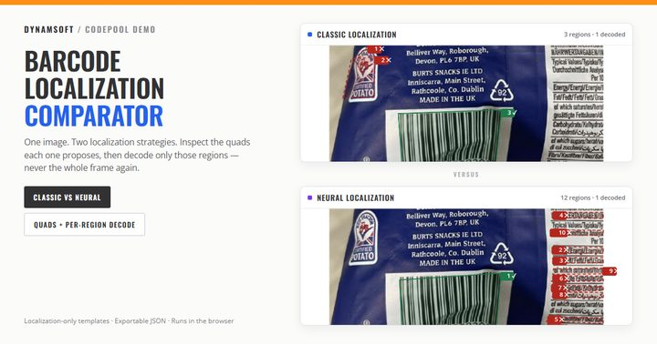

条码读不出来，多数人的第一反应是调解码参数：去模糊、二值化、抗形变。但有一类失败发生在更前面——定位阶段压根没把码当成候选提出来，后面的解码再强也无从下手。问题在于，普通扫描器只告诉你「没读到」，不告诉你「它看的是哪里」。[在线条码定位方式对比器](https://www.dynamsoft.com/codepool/demos/barcode-localization-comparator/)（英文名 Online Barcode Localization Comparator）把这一层拆开：同一张图片，左边经典形状检测，右边神经网络，各自画出它提出的四边形；然后把每个定位到的区域单独裁出来解码。

## 在线演示

[在线条码定位方式对比器](https://www.dynamsoft.com/codepool/demos/barcode-localization-comparator/)（英文名 Online Barcode Localization Comparator）：基于 Dynamsoft Barcode Reader 11.6.5000，选一张图片之前不加载任何 SDK 资源。

配合本文验证时可以这样走一遍：先用内置的标签纸图片，看两块面板的假设数量差多少；再换成褶皱包装袋，注意经典面板可能一个区域都没有，而模型能给出来；最后看第三组的两行耗时——规则已经读到的画面上，模型确实没有产生开销。

## 关键要点

- 两块面板各跑一个**只有定位段**的模板（`ST_BARCODE_LOCALIZATION`），没有解码段，所以 `capture()` 不返回条码。
- 四边形来自 `IntermediateResultReceiver.onLocalizedBarcodesReceived`，那是定位阶段自己的输出。
- 假设数与合并后的区域数分开显示，合并阈值是包围盒 IoU ≥ 0.85。
- 区域解码在裁图上进行：按四点的包围盒裁出来，按滑杆外扩，短边放大到 200 px，再用两边**完全相同**的解码模板跑。
- 第三组跑生产环境的优先级列表：先便宜的形状规则，读不到才落到模型，于是能看到规则已读到的画面上模型不花钱。
- 两份模板都能查看、能导出 JSON。

## 只跑定位：一个没有解码段的模板

要看清定位，就得把解码拿掉。页面构造的模板里只有一段：

```js
// 省略外层 CaptureVisionTemplates / TargetROIDefOptions 包装
{
  Section: 'ST_BARCODE_LOCALIZATION',
  StageArray: [{
    Stage: 'SST_LOCALIZE_CANDIDATE_BARCODES',
    LocalizationModes: modes.map(function (mode) {
      return { Mode: mode };
    })
  }]
}
```

这份模板没有 `ST_BARCODE_DECODING`，所以 `capture()` 的返回值里没有条码——但管线照样跑，定位阶段的中间结果照样产生。四边形通过中间结果接收器拿到：

```js
var receiver = new Dynamsoft.CVR.IntermediateResultReceiver();

// 每个元素的 location 就是一个四边形
receiver.onLocalizedBarcodesReceived = function (results) { /* ... */ };

router.getIntermediateResultManager()
      .addResultReceiver(receiver);
```

一次 capture 里，多轮二值化和增强可能把同一块区域报好几遍。所以面板上有两个数字：**假设数**（原始候选）和**区域数**（按 IoU ≥ 0.85 合并之后）。假设多而区域少，说明算法在反复确认同一块地；两个都少，才是真的没看见。

## 逐区域解码：把差异锁死在区域上

定位阶段的输出只是四边形。要知道「这块区域到底能不能读」，就得把它裁出来单独解码：

1. 取四个点的包围盒；
2. 按滑杆的值向外扩一圈（框太紧会把静区切掉）；
3. 短边缩放到 200 px 以上；
4. 把这张裁图交给第二个模板——这个模板在裁图内部再做一次定位加解码。

关键是两块面板用的是**同一份**解码模板。这样解码列的差异只可能来自区域本身，而不是读取器的配置不同。否则你永远说不清是「模型定位得更好」还是「模型那边的解码参数更宽松」。

## 第三组：生产环境真正跑的优先级列表

前两组回答「各自看到了什么」，第三组回答「线上到底怎么跑」。它做三次全帧解码：

| 行 | 实际跑的模板 | 用途 |
| --- | --- | --- |
| 只经典 | 连通块 + 直线 + 统计 + 直接扫描 | 规则能不能自己搞定 |
| 只神经网络 | 单个 `LM_NEURAL_NETWORK` | 模型单独跑要多久 |
| 优先级列表 | `[连通块, 直线, 统计, 神经网络]` | 生产环境真正用的顺序 |

`LocalizationModes` 是有序列表，解码时按顺序尝试，默认 `ExpectedBarcodesCount` 为 0，也就是**第一个读出条码的模式一出现就停**。所以在规整的标签纸上，优先级列表跑完的时间和「只经典」几乎一样——模型根本没被调用；而在褶皱包装袋上，经典规则返回空，列表继续往下走，最后由模型读出，耗时大约等于两者相加。

这也解释了为什么「顺序」本身就是个参数：把神经网络放到列表最前面，每一帧都要付模型的价钱；放在最后，只在需要时付。每份模板都跑两次、只报第二次，避免首次加载把数字带偏。

## 一个配置坑：LocalizationModes 不在顶层

如果你自己写模板，这一条能省掉半天：把 `LocalizationModes` 平铺在 `BarcodeReaderTaskSettingOptions` 上，SDK **不会报错**，只是静默忽略，于是你以为自己设了神经网络，其实还在跑默认模式。

真正的位置在段落数组的阶段数组里：

```text
SectionArray[Section = ST_BARCODE_LOCALIZATION]
  .StageArray[Stage = SST_LOCALIZE_CANDIDATE_BARCODES]
    .LocalizationModes
```

改完之后用 `getSimplifiedSettings(template)` 回读一次，确认 `barcodeSettings.localizationModes` 里真的是你写的那组模式，而不是默认值。对比器页面的说明里专门写了这一条，因为它的两块面板就踩过。

## 边界

- 一次只对比一张图，不是批量基准。要跑一批图看识别率，用[在线条码扫描器](https://www.dynamsoft.com/codepool/demos/barcode-scanner/)的基准模式。
- 计时是 SDK 时间，不含画布拷贝与中间结果结算，适合横向比较，不适合当作端到端延迟。
- 只跑定位的模板不能代表生产路径：它永远满足不了早退条件，会把整族模式都跑完。
- 「区域解码成功」不等于「整图能读」——真实扫描还要面对多码、去重和排序，那些是另一层问题。
- 定位模式的组合很多，页面给的是四种经典模式加模型，不是穷举。
