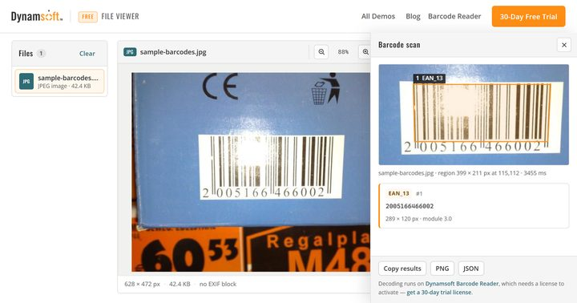

「文件打不开」是文档处理里最常见也最没效率的一类问题：一个后缀是 `.jpg` 的附件其实是 TIFF，一个 `.pdf` 有 300 页而你只当它是一页，一张 HEIC 照片在 Windows 上双击只会弹错误。大多数工具的顺序是先渲染、渲染不出来再报错；[在线文件查看器](https://www.dynamsoft.com/codepool/demos/file-viewer/)（英文名 Online File Viewer）把这个顺序反过来：先量身份，再谈预览。

## 在线演示

[在线文件查看器](https://www.dynamsoft.com/codepool/demos/file-viewer/)（英文名 Online File Viewer）：把文件拖进去就能看，不需要注册。阅读文件本身不加载任何 SDK，只有右键扫条码那一步会加载 Dynamsoft Barcode Reader，而且只在第一次用到时加载。

配合本文验证时可以这样走一遍：拖一张 HEIC 进去看它只报尺寸不给画面；再拖一个 docx，逐页翻一遍；最后在预览区右键框住一个条码，看它把框选结果、码制、模块尺寸一起给出来。

## 关键要点

- 先读文件头判断真实容器，扩展名只当提示；对不上时以字节为准。
- 尺寸、DPI、EXIF 与 GPS 从头部解析，所以 HEIC 这种浏览器解不了的格式也能报尺寸。
- SHA-256 用 `crypto.subtle` 在本地算，上限 64 MB；超限的媒体文件只读 64 字节头。
- 重解析器按需注入：pdf.js、UTIF、SheetJS、JSZip、docx-preview，打开一张图片时它们一个都不加载。
- YUV 原始帧可以自己设宽、高与 row stride，帧数由文件大小推出来。
- 右键框选只解码选框，且向外扩 6%——手画的框通常会切掉静区。

## 先量身份，再谈预览

页面的第一屏不是画面，而是一张属性表。判断真实类型靠文件头的魔数：JPEG 是 `FF D8 FF`，PDF 是 `%PDF-`，ZIP 容器（docx / xlsx / pptx）是 `PK`，ISO-BMFF 家族（HEIC / AVIF / MP4）要先读 `ftyp` 里的 brand 才知道具体是哪一个。扩展名在这套判断里只是提示，改过名的文件会当场露馅。

| 你想知道的 | 页面从哪里得到 |
| --- | --- |
| 真实类型 | 文件头魔数 + ISO-BMFF brand |
| 图像尺寸与像素数 | JPEG SOF、PNG IHDR、ISO-BMFF `ispe` box |
| DPI | JPEG/EXIF 的分辨率标签、TIFF 的 XResolution 与单位、PNG 的 `pHYs` |
| 拍摄参数与位置 | EXIF 全表：相机、镜头、曝光、方向、GPS |
| 页数 | PDF 由 pdf.js 打开后给出，TIFF 一个 IFD 一页，YUV 由文件大小推算 |
| 文件指纹 | `crypto.subtle.digest('SHA-256', buffer)` |

指纹这一项有个诚实的边界：SHA-256 必须读完整份文件，所以页面设了 64 MB 上限。超过上限的音视频文件只读前 64 字节做识别——为了读一个时长去把 400 MB 塞进内存没有意义，代价是这类文件不显示哈希。

## 八类格式，各自给什么

| 格式族 | 覆盖 | 能读到的东西 |
| --- | --- | --- |
| 图片 | JPEG、PNG、GIF、WebP、AVIF、BMP、ICO、SVG、HEIC（仅头部） | 尺寸、像素数；JPEG/TIFF 另有完整 EXIF |
| TIFF | TIF、TIFF | 一个 IFD 一页，含压缩方式、位深、分辨率 |
| PDF | PDF | pdf.js 逐页渲染，页尺寸（point）、PDF 版本、生成器与日期 |
| Office | DOCX、XLSX、PPTX | Word 按节、表格按 40 行一页、演示按幻灯片分页 |
| 文本 | TXT、MD、LOG、JSON、XML、CSV、TSV | 编码检测（UTF-8 / UTF-16 / GBK / cp1252）、行号、JSON 美化、表格化 |
| 音视频 | MP4、WebM、MOV、M4V、MP3、WAV、OGG | 时长、分辨率、宽高比，然后交给浏览器自己的解码器 |
| 原始帧 | YUV、NV21、NV12、I420、YV12 | 像素格式、宽高、row stride 自己填，帧数由文件大小推 |
| 其它 | — | 只报容器类型，不画假预览 |

Office 那一行值得说清楚：docx 用 docx-preview 渲染，xlsx 用 SheetJS 按块切页，pptx 则是自己用 JSZip 读出 `ppt/presentation.xml`，从 `sldSz` 的 EMU 值换算出页面尺寸再排版。所以它是**结构预览**——标题、正文、表格、幻灯片顺序都对，但别指望和 PowerPoint 的像素级还原一致。

## 右键框选：在原分辨率上解码

预览区右键有「Scan barcodes here」：页面变暗，拖出一个框，四角可以调，框内可以整体移动。点「Read barcode」之后：

1. 裁切。图片、PDF、TIFF、YUV 帧和暂停的视频帧按**原始像素**裁；Word、Excel、PowerPoint 和文本页没有原始像素，用 html2canvas 按 devicePixelRatio 把当前页光栅化后再裁。
2. 外扩。裁切框每边放大 6%，因为手画的框几乎总会切掉一点静区。
3. 解码。只有这块裁图进入 Barcode Reader。
4. 标注。叠加层画在**实际被解码的那张裁图**上，所以框住的像素和你看到的像素是同一份，不会错位。

结果面板给每个条码一张卡：码制、解码文本、像素尺寸、模块尺寸、角度，可以复制 JSON、存标注后的 PNG，或者把同一份 payload 存成文件。

## 边界

- HEIC 只读头部：尺寸能报，画面不能画。
- 哈希上限 64 MB，超限不显示，不会退化成弱校验。
- Office 与 PPTX 是结构渲染，复杂版式、艺术字、嵌入对象可能与原软件有差异。
- 条码扫描是「截屏式」的，效果取决于当前渲染分辨率——一页缩得很小的 PDF，先放大再框选。
- 页面要用 `http://` 或 `https://` 打开：样例文件用 `fetch()` 取，`crypto.subtle` 也只在安全上下文里可用，`file://` 双击打开会缺这两项能力。
