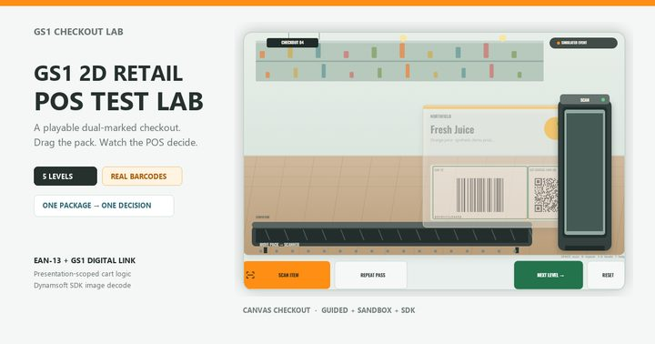

零售条码正在往二维迁移，技术上「能不能扫到」早就不是瓶颈。真正的麻烦在收银台：一件商品同时印着 EAN-13 和 GS1 Digital Link 二维码，顾客把它在扫码器前晃一下，两个码可能都被读到——这一下算一件还是两件？如果两个码给出的 GTIN 还不一样，又该怎么办？[在线 GS1 二维条码 POS 演练](https://www.dynamsoft.com/codepool/demos/gs1-2d-pos-test-lab/)（英文名 Online GS1 2D Retail POS Test Lab）把这块画布做成一个可以照着按的收银台，让判定过程一步步摊开在屏幕上。

## 在线演示

[在线 GS1 二维条码 POS 演练](https://www.dynamsoft.com/codepool/demos/gs1-2d-pos-test-lab/)（英文名 Online GS1 2D Retail POS Test Lab）：点击「Scan Item」、按空格，或者把商品包拖进扫码口。数字键 1–5 切关卡，R 重放同一次出示，G / B / D 切引导、沙盒、SDK 三种模式，问号键随时叫回说明。模拟部分不需要任何许可证。

配合本文验证时可以这样走一遍：先在第 3 关（双标识）扫一次，看小票只加一件；再到第 4 关把同一件商品扫两次，看它加两件；最后进第 5 关，看两个载体 GTIN 不一致时收银台怎么挂起。

## 关键要点

- 判定单位是**一次出示**（presentation），不是一条码。一次出示里读到几个码，都只可能产生一次加购。
- GTIN 先归一化成 14 位并校验校验位，8 / 12 / 13 / 14 位输入都能进来。
- 同一次出示里多个载体指向同一 GTIN：只加一件，理由是 `MATCHED_CARRIERS_ONE_PRESENTATION`。
- 两个不同 GTIN：`needs_review` + `GTIN_CONFLICT`，不加购，把两个 GTIN 一起报上去。
- 重复提交同一次出示不会再加一件（`SAME_PRESENTATION`），同款商品要加两件必须出示两次。
- 模拟结果和 SDK 解码结果分两列呈现，夹具数据永远不会顶替真实解码结果。

## 五个引导关卡

关卡数据来自 `fixtures.json`，每一关都写死了载体、出示次数和期望结果——这也是它可被回归测试的原因（`test-pos-engine.cjs` 在 Node 里跑同一套规则）。

| 关卡 | 载体 | 出示次数 | 期望结果 |
| --- | --- | --- | --- |
| 1 传统条码 | EAN-13 | 1 | 加一件 |
| 2 只有二维码 | GS1 Digital Link QR | 1 | 加一件 |
| 3 双标识 | EAN-13 + 同 GTIN 的二维码 | 1 | 加一件 |
| 4 两件商品 | 双标识 | 2 | 加两件 |
| 5 GTIN 冲突 | EAN-13 + 不同 GTIN 的二维码 | 1 | 挂起复核，不加 |

第 3 关是整个迁移的核心场景：只要判定落在「一次出示」这个单位上，两个载体就是同一件商品的两张身份证，而不是两件商品。第 4 关反过来提醒：去重不能过头——同一件商品被真实地出示两次，就该是两件。

## 判定规则：以一次出示为单位

规则全在 `pos-engine.js` 里，没有 DOM、没有 SDK、没有动画，所以同一份逻辑可以在 Node 里跑测试。核心函数收一次出示和它读到的所有观测，返回一个明确的状态：

```js
// 简化后的判定顺序，对应 pos-engine.js 的 completePresentation
if (!observations.length)
  return { status: 'not_added', reason: 'NO_RESULT' };

if (uniqueGtins.length > 1)
  return {
    status: 'needs_review', reason: 'GTIN_CONFLICT', gtins: uniqueGtins
  };

if (!uniqueGtins.length) {
  var reason = checkDigitFailed ? 'INVALID_GTIN' : 'NO_VALID_GTIN';
  return { status: 'not_added', reason: reason };
}

if (!catalog[gtin])
  return { status: 'needs_review', reason: 'UNKNOWN_PRODUCT', gtin: gtin };

if (presentation.wasCommitted)
  return { status: 'ignored', reason: 'SAME_PRESENTATION', gtin: gtin };

cart[gtin].quantity += 1;
return { status: 'added', reason: 'VALID_GTIN', quantityAdded: 1 };
```

几个选择值得说清楚：

- **校验位不过就是不过**。GTIN 归一化到 14 位之后重新验算校验位，`INVALID_CHECK_DIGIT` 单独成一个原因，而不是混进「没读到有效码」。
- **冲突不自动裁决**。两个载体给出不同 GTIN，`needs_review` 是唯一诚实的答案——包装印错、贴错标签、条码被改，三种情况的处理方式不一样，机器不该替人决定。
- **未知商品也是复核**。GTIN 合法但本地目录里没有，说明后台还没建档，不是「读错了」。
- **去重挂在出示上**。`wasCommitted` 是出示对象的属性，所以重复提交同一次出示返回 `ignored`，再扫一次新的出示才会加购。

## 决策记录与能带走的产物

画布上一共只画一块 canvas：超市货架、传送带、真实包装、扫码口、小票、购物车、反馈，全是画出来的。每次判定都会往决策轨迹里追加一条——读了哪几个码、各自解析成什么、最后为什么这么判。这比只看小票多一件少一件有用：出问题时能指着某一条说「就是这一步判错了」。

可导出的东西有三类：

1. **场景 PNG**：当前这一帧的收银台画面。
2. **测试标签 PNG**：当前商品的条码标签，可以打印出来给真实扫描枪试。
3. **JSON / CSV 报告**：每一关的输入、判定、期望值与是否一致。

关卡本身也是数据：`fixtures.json` 带 schema 版本，改关卡等于改数据，不改代码。

沙盒模式（B）把商品、载体、二维码载荷和夹具全部开放，可以自己组合出引导关卡里没有的情况——比如只印二维码但载荷里 GTIN 校验位错一位，看判定怎么走。

## 解码是解码，模拟是模拟

页面里还有一块 Real Decode：用 Dynamsoft Capture Vision 解码当前生成的标签，或者你自己上传的图片。它和模拟判定是**两条独立的证据链**：模拟层的输入由夹具显式给出，解码层的结果由 SDK 真实给出，两者分列，谁也不覆盖谁。页面上的原话是「报告真实结果，包括没有结果和错误」——失败也照实显示。

这个设计是为了避免演示工具最常见的毛病：用一套假数据证明自己「能读」。这里能证明的只有两件事——判定规则对不对，以及生成的标签能不能被真的解码器读出来。

## 边界

- 模拟层显式告诉引擎「这是哪一次出示」。真实收银台要靠扫码时序、重量、防盗标签去推断，这部分不在演示范围内。
- 不是 GS1 认证，不是扫描枪资格测试，也不是印品质量检测。页面在 `limits` 字段里写了这三条。
- 目录与价格是虚构的，且价格与条码内容无关。
- 判定规则是示范实现，不是标准条文；真实 POS 还要处理称重商品、批次追溯、退货冲正。
