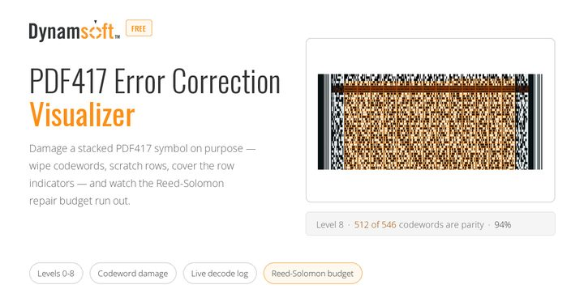

「这个 PDF417 用 4 级纠错」——这句话单独听是没有信息量的。PDF417 的纠错级别 0 到 8 对应的是**固定的校验码字数**：0 级 2 个，8 级 512 个。同样一个 4 级（32 个校验码字），在只有 33 个码字的短符号上占了绝大部分，在 546 个码字的长符号上只占 5.9%。抗损能力取决于比例，而级别只告诉你分子。[在线 PDF417 纠错与损伤可视化工具](https://www.dynamsoft.com/codepool/demos/pdf417-error-correction-visualizer/)（英文名 Online PDF417 Error Correction & Damage Visualizer）就是把这个分子分母同时摊开的工具。

## 在线演示

[在线 PDF417 纠错与损伤可视化工具](https://www.dynamsoft.com/codepool/demos/pdf417-error-correction-visualizer/)（英文名 Online PDF417 Error Correction & Damage Visualizer）：选级别、改载荷、画损伤、跑解码，全程在浏览器内完成。编码器是页面自带的 ISO/IEC 15438 实现，没有依赖，也不联网。

配合本文验证时可以这样走一遍：同样一段文字，先在 1 级生成一次，再把级别拉到 8 级，看符号从几行变成几十行、柱状图里校验码字的占比怎么变；然后用笔刷擦掉几个码字，看仪表和实际解码分别在哪一步翻脸。

## 关键要点

- 级别 0–8 对应 `k = 2^(level+1)` 个校验码字：2、4、8、16、32、64、128、256、512。
- 一个 PDF417 符号上限是 928 个码字、90 行、30 列；级别越高，留给载荷的越少。
- 每个码字占 17 个模块，页面按颜色区分载荷、填充（900）、校验、行指示符与起止/保护图形。
- 破坏方式分三类：擦码字、刮整行整列、盖行指示符或打断起止符。三者的失效模式完全不同。
- 仪表同时按两个上界统计：⌊k/2⌋ 个未知错误、k 个擦除。
- 解码回报行数、列数、级别与码字数，等于用解码器反向校验编码器。

## 级别买到的是绝对码字数

| 级别 | 校验码字 k | 一句短载荷（33 个码字） | 一段长载荷（546 个码字） |
| --- | --- | --- | --- |
| 0 | 2 | 6% | 0.4% |
| 2 | 8 | 24% | 1.5% |
| 4 | 32 | —（装不下） | 5.9% |
| 8 | 512 | —（装不下） | 94% |

最后两行不是笔误：级别一高，短载荷反而无法编码。编码器的检查很直白——`payload + k + 1 > 928` 就抛错，提示你缩短内容或降低级别。`+1` 是那个记录码字总数的长度描述符。

页面下方有一排柱子，按当前载荷把九个级别各自的校验占比画出来。这根柱子是这个工具最实用的一块：它把「级别」从一个名词变成了一个百分比，而百分比才是决定「能扛几个码字」的东西。

## 把符号拆开：每一格是什么

PDF417 的每一行由「起始符 + 左行指示符 + 数据区 + 右行指示符 + 终止符」组成，数据区里的每个码字画成 17 个模块宽的一格。页面的解剖视图用颜色区分：

- **载荷码字**：你输入的文本编码后的内容；
- **填充码字**：固定值 900，把数据区补满；
- **校验码字**：Reed-Solomon 算出来的 k 个；
- **行指示符**：每行左右各一个，携带行号、行数、列数与纠错级别；
- **起止与保护图形**：起始符 17 模块、终止符 18 模块，加上每行两端的保护条。

点任意一格，能读到它的码字序号和值。有一个细节值得注意：PDF417 有三套码字表（cluster 0、3、6），第 r 行按 `r % 3` 选一套，行指示符本身也用该 cluster 的编码规则——所以同一行号在不同行上长得不一样，这不是渲染错误。

## 三种破坏方式，三种失效模式

这是这个工具与「画几个噪点看看」的区别：不同的损伤打在不同的结构上，失效的原因根本不同。

| 破坏方式 | 打在哪 | 为什么失败 |
| --- | --- | --- |
| 笔刷擦码字 | 数据区里的单个码字 | 未知错误增加，⌊k/2⌋ 先到上限 |
| 刮掉一整行 / 一整列 | 整行码字连同行指示符 | 行结构丢了，解码器可能连「这一行在哪」都判断不出来 |
| 盖住三行行指示符 | 行号、行数、列数 | 符号几何信息缺失，纠错码字再多也补不回来 |
| 打断起止符 | 每行的起点与终点 | 行边界识别失败，属于「找不到了」而不是「读错了」 |

再加一组传感器层面的模拟：噪点、失焦模糊、低对比度、低分辨率、遮挡、裁切、阴影、倾斜，每项带强度滑杆。这些不是码字错误，而是让定位与二值化先出问题——真实场景里，扫描失败大多发生在这一层，而不是纠错预算耗尽。

## 用解码器反验编码器

页面里有两套独立的判断：

1. **仪表**：按 ⌊k/2⌋ 与 k 两个上界，数你弄坏了多少个码字，算出还剩多少预算。这是模型，取决于编码器对自己结构的认知。
2. **解码器**：Dynamsoft Barcode Reader 去读受损后的渲染图，回报它实际读出的行数、列数、纠错级别、行指示符与码字数，以及载荷是否与原文一致。

两者对照才有意义。如果仪表说「还在预算内」而解码器读不出来，说明失败发生在纠错之前（定位、二值化）；如果仪表说「超了」而解码器仍读得出，说明 Reed-Solomon 用上了擦除信息，实际能力比最坏情况好。

固定种子的码字扫描把这个过程自动化：从 0 开始逐个破坏码字，记录每一步解码成功还是失败，把 ⌊k/2⌋ 与 k 两条界画在同一根轴上。每一步都留一张 PNG，是**被解码的那张渲染图**，不是重新生成的示意图——所以拿去复核时，看到的就是当时的证据。

## 边界

- 这是软件模拟，不是印品质量检测；ISO/IEC 15415 那类分级要看静区、对比度、调制比、轴向不一致性等一整套指标。
- 纠错预算只算码字层面。真实读取还取决于扫描端的定位、二值化与图像分辨率，这些都可能在纠错之前就失败。
- 级别上限 8 是规范约束，载荷与校验合计不能超过 928 个码字；超了就是编码失败，不是「压缩一下」能绕过的。
- 页面里的编码器实现了 ISO/IEC 15438 的码字与纠错部分，用于教学与验证；正式印刷标签请用成熟的编码库，并做印品检测。
